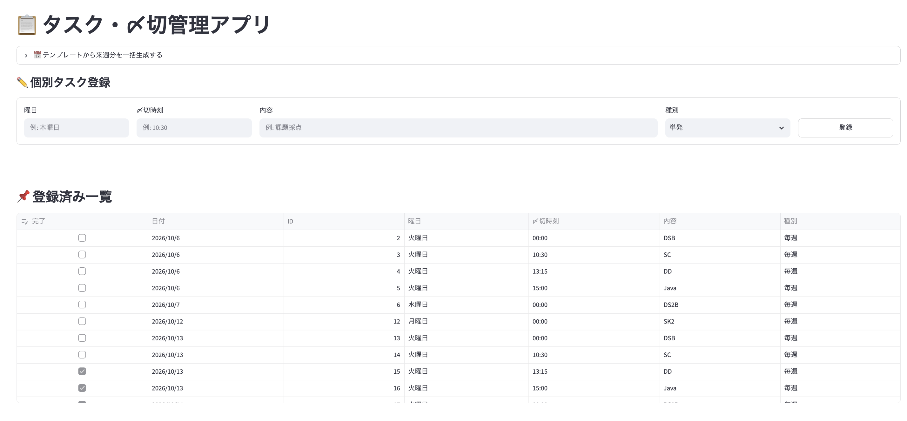
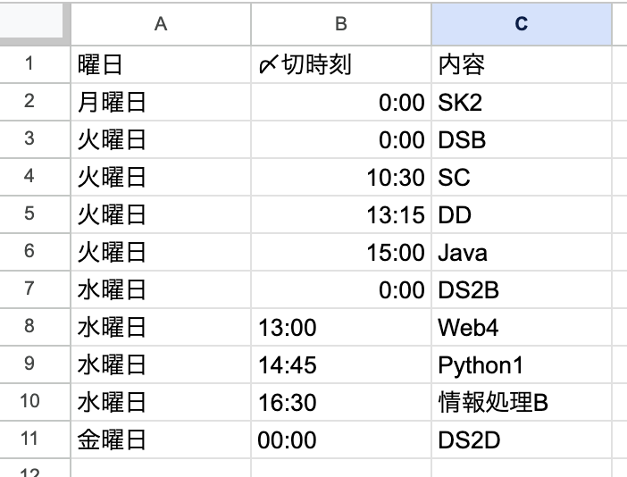
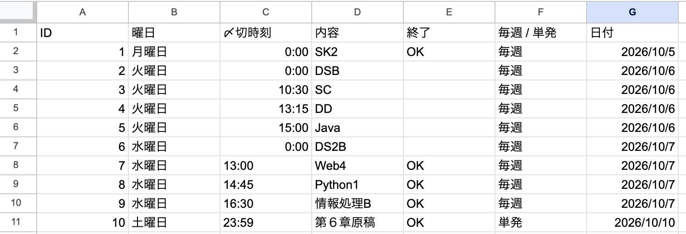

# タスク・〆切管理アプリ

毎週発生するルーティンタスクおよび不定期な単発タスクの〆切を一元管理するためのWebアプリケーションです。

---

## 1. 目的

毎週決まった曜日に発生するルーティンタスクの抜け漏れを防ぐとともに、時々発生する単発の仕事も柔軟に管理することを目的としています。

---

## 2. 主な機能

- **毎週タスクの登録**
  - 曜日・〆切時刻・内容を指定し、定期タスクとして登録可能
- **単発タスクの登録**
  - 不定期に発生する個別タスクを登録可能
- **1週間分のタスク一括生成**
  - 基準となる日曜日を指定することで、テンプレート（ひな形）から翌週分のタスクを自動計算して一括展開
- **ワンクリック完了記録**
  - 一覧上のチェックボックスをONにするだけで、即座に完了状態（OK）を記録
- **タスク・〆切の自動ソート一覧表示**
  - 日付および〆切時刻の早い順に自動整列して一覧表示
- **過去の完了タスクの非表示フィルタ**
  - 今日以前に完了したタスクは一覧から自動除外（未完了のタスクは過去分でもやり残し防止のため表示を維持）

---

## 3. データの記録方式

- **バックエンドストレージ**: Google スプレッドシート
  - `tasks` シート: 実際の実行タスク・実績ログ（ID、曜日、〆切時刻、内容、終了、種別、日付）
  - `template` シート: 毎週発生するルーティンタスクのマスターデータ

---

## 4. 使用技術

- **フロントエンド / ホスティング**: Streamlit (Streamlit Community Cloud)  
- **データベース**: Google スプレッドシート
- **開発言語**: Python / JavaScript

---

## 5. 今後の拡張予定

- 毎週日曜日に翌週分のタスクを自動生成するGASトリガー（定期バッチ実行）の実装
- スマートフォン対応
- 契約サーバへの実装
- タスクの量や質や積み残しなどを日記風に書き込める機能を追加してどこに問題があったか振り返りができるようにしたい
